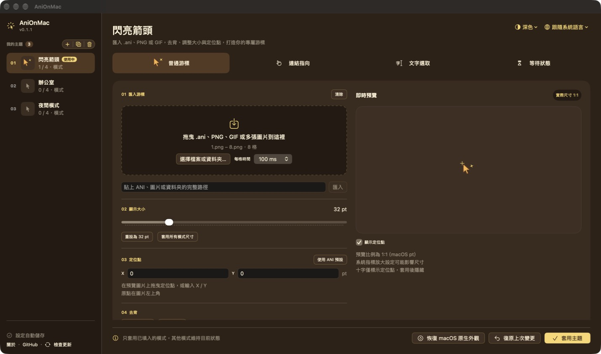
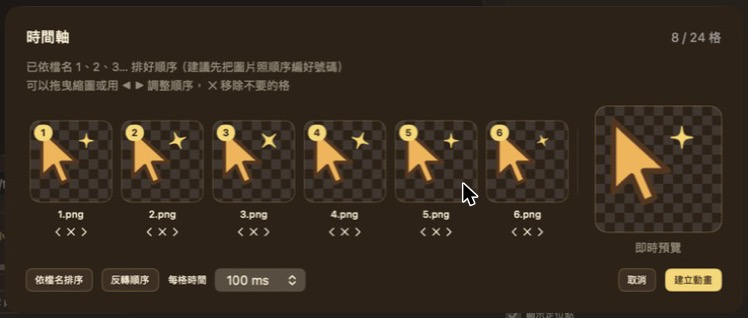
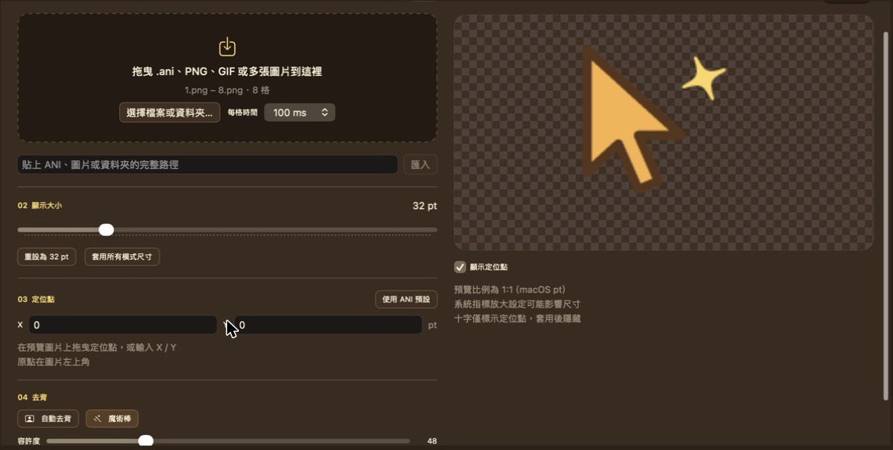

<div align="center">


# AniOnMac

**Mac のためのアニメーションカーソル工房**

`.ani`・PNG・GIF を読み込み、ワンクリックで背景を削除、サイズとホットスポットを調整して自分だけのカーソルに。

[](#compatibility)
[](#compatibility)
[](https://github.com/lx3211/AniOnMac/releases/latest)

[English](README.md) · [繁體中文（臺灣）](README.tw.md) · **日本語** · [한국어](README.ko.md)



</div>

---

## 特長

| | |
| --- | --- |
| **どんな素材でも** | Windows の `.ani`、1 枚の PNG／JPG、アニメーション GIF（APNG／WebP も可）、番号付き画像のフォルダ |
| **タイムライン** | 複数の画像はまずタイムラインで開きます。ドラッグで並べ替え、◀ ▶ で微調整、不要なコマの削除、コマ時間の設定、ライブプレビュー |
| **背景削除** | **自動**は macOS Vision で被写体を切り抜き、**自動選択ツール**はクリックした色を削除 |
| **正確なホットスポット** | 1:1 プレビュー上でドラッグするか X／Y を入力。アニメーション・速度・ホットスポットは常に同期 |
| **ホットスポットの補正** | 自分のカーソルで 5 つの点を順にクリックすると、先端のずれを測ってホットスポットを自動で補正 |
| **描画スタイル** | モードごとに **高解像度**（なめらかな輪郭）、**ドット絵**（ドットが見える）、**ギザギザ**（昔のカーソルのような硬い輪郭）から選択 |
| **テーマ** | 番号付きのテーマを無制限に作成、使用中のテーマには「使用中」タグ、自動保存と取り消し |
| **ライト／ダーク** | システムに合わせるか手動で選択。ダークはプリンをイメージしたキャラメルブラウンとカスタード |
| **4 か国語** | 繁體中文（臺灣）・English・日本語・한국어。既定ではシステムに合わせ、メニューバーも切り替わります |
| **アップデート確認** | GitHub の新しいリリースとプッシュを確認 |

## インストール

1. [**Releases**](https://github.com/lx3211/AniOnMac/releases/latest) から **`AniOnMac-macOS-universal.dmg`** をダウンロードします。
2. DMG をダブルクリックし、開いたウインドウで **AniOnMac** を **アプリケーション** フォルダにドラッグします。
3. ディスクイメージを取り出します。Finder のサイドバーで **AniOnMac** の横の取り出しボタンをクリックします（ゴミ箱にドラッグしても構いません）。
4. **アプリケーション** フォルダまたは Launchpad から **AniOnMac** を開きます。

### 初回起動を許可する

AniOnMac は Apple の公証を受けていないため、初回は macOS にブロックされます。

1. 「Apple は AniOnMac を検証できませんでした」と表示されたら、**完了** をクリックします（ゴミ箱には入れないでください）。
2. **システム設定 → プライバシーとセキュリティ** を開き、**セキュリティ** までスクロールします。
3. 「Mac を保護するために AniOnMac がブロックされました」の横の **このまま開く** をクリックします。
4. パスワードまたは Touch ID で確認し、続いて表示されるダイアログで **このまま開く** をクリックします。

次回からは普通に開けます。Apple の説明：[開発元が不明な Mac アプリを開く](https://support.apple.com/ja-jp/102445)

> [!TIP]
> 「**壊れているため開けません**」と表示される場合は、ダウンロードしたファイルが隔離されたままです。ターミナルで次を実行してから、もう一度開いてください。
> `xattr -dr com.apple.quarantine /Applications/AniOnMac.app`

アップデートするときは、AniOnMac を終了し、**アプリケーション** 内の旧版を新しい版で置き換えます。テーマはそのまま残ります。ZIP 版（`AniOnMac-macOS-universal.zip`）もあります。展開した `AniOnMac.app` を **アプリケーション** に移動し、あとは同じ手順です。

## はじめかた

1. 上部でモード（**通常の選択**・**リンクの選択**・**テキスト選択**・**待ち状態**）を選びます。
2. `.ani`・PNG・GIF、または画像フォルダをドロップします。
3. サイズ・描画スタイル・ホットスポット・背景を調整し、**テーマを適用**（<kbd>⌘</kbd> <kbd></kbd>）を押します。

## カーソルを作る

### 画像から

- **1 枚の画像**は静止カーソルになります。
- **1 つの GIF** はコマと速度をそのまま保持します。24 コマを超える場合は、全体の長さを保ったまま 24 コマに均等に間引きます。
- **複数の画像やフォルダ**はタイムラインで開きます。先にファイル名を順番どおり（`1.png`、`2.png`…`10.png`）付けておくと便利です。並び順は Finder と同じで、`10` は `9` の後になります。タイムラインでいつでも並べ替えられます。

<div align="center"></div>

### 背景を削除

ホットスポット設定の下にある「**04 背景を削除**」を使います。

- **自動で削除** — macOS Vision で被写体を検出します。検出できない場合（フラットなアイコンやピクセルアートなど）は縁の背景色を削除します。
- **自動選択ツール** — プレビューが拡大され、透明部分は市松模様で表示されます。消したい色をクリックすると、つながった近い色が削除されます。囲まれた部分は個別にクリックしてください。**許容値**で同じ色とみなす範囲を調整します。
- **元の画像に戻す**で削除前の状態に戻せます。

どの素材でも、コマ順・速度・ホットスポットは保持されます。

<div align="center"></div>

### ホットスポットの補正

ホットスポットは、実際にクリックされる位置です。見えている先端とクリック位置が少しずれる場合は、**03 ホットスポット** の横の **補正** を押します。

1. 補正エリアの中では、ポインタが編集中のカーソルに変わります。大きさは適用後と同じです。
2. 見えている先端を各点の中心に合わせてクリックします。点は 5 つあり、点から離れすぎたクリックは数えません。
3. ずれの平均（最も外れた 1 回を除く）と、補正後の X／Y が表示されます。
4. **このホットスポットを使う** を押し、**テーマを適用** を押します。

### 描画スタイル

**02 サイズ** の下で、モードごとに選べます。

| スタイル | 見た目 |
| --- | --- |
| 高解像度 | なめらかに拡大縮小し、輪郭も柔らかく描きます（標準） |
| ドット絵 | 粗いマス目（1 マス 2 pt）で描くので、ドットが見えます |
| ギザギザ | 中はなめらかですが、各ピクセルは不透明か透明のどちらかで、輪郭が段々になります |

プレビューと補正中のカーソルは、適用後と同じスタイルで表示されます。

### カーソルのモード

| モード | 表示されるとき |
| --- | --- |
| 通常の選択 | ふだんのポインタ |
| リンクの選択 | リンクや操作できる要素の上（クリック中の状態ではありません） |
| テキスト選択 | テキストを選択するとき |
| 待ち状態 | macOS や App が処理中のとき（表示のタイミングはシステムが決めます） |

設定したモードだけが適用され、それ以外は変わりません。「**macOS の標準カーソルに戻す**」でいつでも 4 種類すべてを Apple の標準に戻せます。

## ソースからビルド

```sh
xcode-select --install          # Command Line Tools が未インストールの場合
sh development/build.sh         # AniOnMac.app をビルド（arm64 + x86_64）
sh development/test.sh          # 変換・カーソル・App 状態のテスト
sh development/package.sh       # リリース用 ZIP を作成
```

> [!TIP]
> ビルドが `external macro implementation type 'SwiftUIMacros.StateMacro' could not be found` で止まる場合、Command Line Tools の SDK に SwiftUI のマクロプラグインがありません。Xcode をインストールするか、古い SDK でビルドしてください:
> `SDKROOT=/Library/Developer/CommandLineTools/SDKs/MacOSX26.5.sdk sh development/build.sh`

## <a id="compatibility"></a>対応環境

| 項目 | 状況 |
| --- | --- |
| 最低システム | macOS 14 Sonoma |
| Apple Silicon | macOS 26 で動作確認済み |
| Intel | ネイティブ x86_64 版を同梱、実機では未確認 |
| macOS 14／15 | 旧カーソル名に対応、実機では未確認 |
| macOS 26 以降 | ArrowS／IBeamS のカーソル名を使用 |
| アニメーション | 1 カーソルあたり最大 24 コマ（WindowServer の制限） |

## データの保存場所

すべて `~/Library/Application Support/AniOnMac/` に保存されます。

| パス | 内容 |
| --- | --- |
| `library.json` | テーマ・言語・外観・使用中のテーマ |
| `assets/` | 読み込んだカーソルのコピー（元ファイルは移動・削除可） |
| `previews/` | アニメーションのプレビュー画像 |
| `backups/` | テーマごとのシステムカーソルのバックアップ（「**直前の変更を元に戻す**」で使用） |
| `native-reset-recovery.cape` | 直前の「**macOS の標準カーソルに戻す**」より前のカーソル状態 |

## プロジェクト構成

```text
AniOnMac/
├── README.md / README.tw.md / README.ja.md / README.ko.md
├── docs/images/               # README で使う画像
└── development/
    ├── app/
    │   ├── Studio.swift       # テーマ・保存・適用・取り消し・アップデート・背景削除
    │   └── Views.swift        # 画面・タイムライン・アニメーションプレビュー
    ├── native/
    │   ├── ANIConverter.swift # ANI／画像／GIF の読み込み、アニメーション作成、背景削除
    │   ├── cursorctl.m        # システムカーソルの登録・バックアップ・検証
    │   ├── native_defaults.h  # Apple 標準のカーソル画像を読み込み
    │   └── CursorRefresh.m    # ライブ更新とボタンのカーソル
    ├── resources/             # en／zh-Hant／ja／ko の翻訳と App アイコン
    ├── tests/                 # 変換・カーソル・App 状態のテスト
    ├── build.sh · test.sh · package.sh
    └── tools/                 # アイコン生成ツール
```

言語を追加するには、`languageName` を含む `development/resources/<言語コード>.json` を置くだけで、App が自動的に一覧に表示します。

---

<div align="center">

作者 **[lx3211](https://github.com/lx3211)** · [github.com/lx3211/AniOnMac](https://github.com/lx3211/AniOnMac)

</div>
