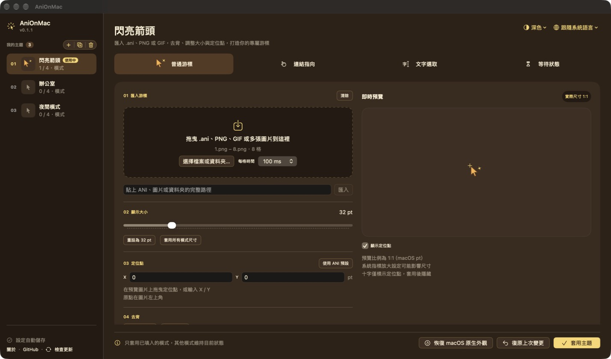
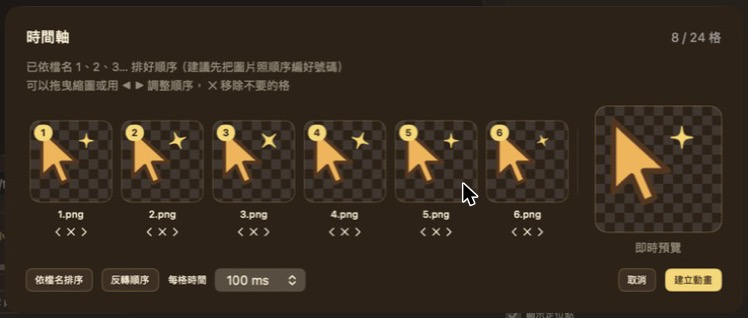
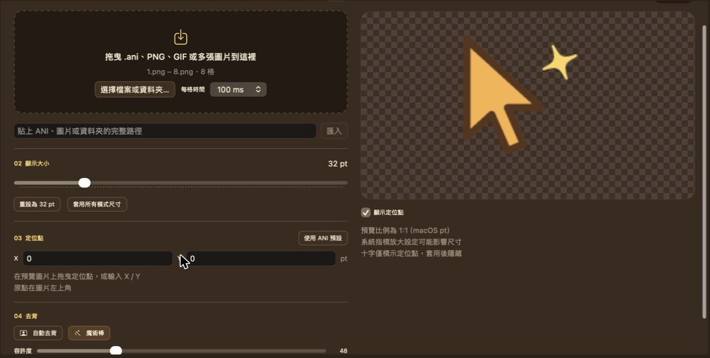

<div align="center">


# AniOnMac

**Mac을 위한 애니메이션 커서 스튜디오**

`.ani`, PNG, GIF를 가져와 한 번에 배경을 지우고 크기와 핫스팟을 조정해 나만의 커서를 만드세요.

[](#compatibility)
[](#compatibility)
[](https://github.com/lx3211/AniOnMac/releases/latest)

[English](README.md) · [繁體中文（臺灣）](README.tw.md) · [日本語](README.ja.md) · **한국어**



</div>

---

## ✨ 주요 기능

| | |
| --- | --- |
| 🎞️ **어떤 소스든** | Windows `.ani`, PNG／JPG 한 장, 움직이는 GIF(APNG／WebP도 가능), 번호를 붙인 이미지 폴더 |
| 🧭 **타임라인** | 여러 이미지는 먼저 타임라인에서 열립니다. 드래그로 순서 변경, ◀ ▶로 미세 조정, 프레임 삭제, 프레임 시간 설정, 실시간 미리보기 |
| 🪄 **배경 제거** | **자동**은 macOS Vision으로 피사체를 오려 내고, **마술봉**은 클릭한 색을 지웁니다 |
| 🎯 **정확한 핫스팟** | 1:1 미리보기에서 드래그하거나 X／Y를 입력. 애니메이션, 속도, 핫스팟이 항상 함께 유지됩니다 |
| 🗂️ **테마** | 번호가 붙은 테마를 무제한으로, 적용 중인 테마에는 「사용 중」 태그, 자동 저장과 실행 취소 |
| 🌗 **라이트 & 다크** | 시스템 설정을 따르거나 직접 선택. 다크 모드는 푸딩을 떠올리게 하는 캐러멜 브라운과 커스터드 색상 |
| 🌐 **4개 언어** | 繁體中文（臺灣）, English, 日本語, 한국어. 기본적으로 시스템 언어를 따르며 메뉴 막대도 함께 바뀝니다 |
| 🔄 **업데이트 확인** | GitHub의 새 릴리스와 새 푸시를 확인 |

## 🚀 빠른 시작

1. [**Releases**](https://github.com/lx3211/AniOnMac/releases/latest)에서 `AniOnMac-macOS-universal.zip`을 내려받아 압축을 풀고 `AniOnMac.app`을 엽니다.
2. 위쪽에서 모드를 고릅니다: **기본 포인터**, **링크 선택**, **텍스트 선택**, **대기 상태**.
3. `.ani`, PNG, GIF 또는 이미지 폴더를 끌어 놓습니다.
4. 크기, 핫스팟, 배경을 조정하고 **테마 적용**(<kbd>⌘</kbd> <kbd>↩</kbd>)을 누릅니다.

> [!NOTE]
> 처음 실행할 때 [macOS 보안 설정](https://support.apple.com/ko-kr/102445)에 의해 차단될 수 있습니다. **시스템 설정 → 개인정보 보호 및 보안**에서 **그래도 열기**를 클릭한 뒤 **열기**를 누르세요.

## 🎨 커서 만들기

### 이미지로 만들기

- **이미지 한 장**은 정지 커서가 됩니다.
- **GIF 하나**는 원래의 프레임과 속도를 그대로 유지합니다. 24프레임을 넘으면 전체 길이를 유지한 채 24프레임으로 고르게 줄입니다.
- **여러 이미지나 폴더**는 타임라인에서 열립니다. 미리 파일 이름에 순서대로 번호(`1.png`, `2.png` … `10.png`)를 붙여 두면 편합니다. 정렬은 Finder와 같아서 `10`은 `9` 다음에 옵니다. 타임라인에서 언제든 순서를 바꿀 수 있습니다.

<div align="center"></div>

### 배경 제거

핫스팟 설정 아래의 「**04 배경 제거**」를 사용하세요.

- **자동 제거** — macOS Vision으로 피사체를 감지합니다. 감지되지 않으면(플랫 아이콘, 픽셀 아트 등) 가장자리 배경색을 제거합니다.
- **마술봉** — 미리보기가 확대되고 투명한 부분은 체크무늬로 표시됩니다. 지울 색을 클릭하면 이어진 비슷한 색이 제거됩니다. 둘러싸인 영역은 따로 클릭하세요. **허용 범위**로 같은 색으로 볼 범위를 정합니다.
- **원본으로 복원**으로 배경 제거 전 상태로 돌아갈 수 있습니다.

어떤 소스든 프레임 순서, 속도, 핫스팟이 유지됩니다.

<div align="center"></div>

### 커서 모드

| 모드 | 나타나는 때 |
| --- | --- |
| 기본 포인터 | 평소의 마우스 포인터 |
| 링크 선택 | 링크나 상호작용 가능한 요소 위(마우스를 누른 상태가 아님) |
| 텍스트 선택 | 텍스트를 선택할 때 |
| 대기 상태 | macOS나 앱이 바쁠 때(표시 시점은 시스템이 결정) |

설정한 모드만 적용되고 나머지는 그대로 유지됩니다. 「**macOS 기본 커서로 복원**」으로 언제든 네 가지 커서를 Apple 기본 모양으로 되돌릴 수 있습니다.

## 🛠️ 소스에서 빌드

```sh
xcode-select --install          # Command Line Tools가 없을 때
sh development/build.sh         # AniOnMac.app 빌드(arm64 + x86_64)
sh development/test.sh          # 변환, 커서, 앱 상태 테스트
sh development/package.sh       # 릴리스용 ZIP 만들기
```

> [!TIP]
> 빌드가 `external macro implementation type 'SwiftUIMacros.StateMacro' could not be found`에서 멈추면 Command Line Tools SDK에 SwiftUI 매크로 플러그인이 없는 것입니다. Xcode를 설치하거나 이전 SDK로 빌드하세요:
> `SDKROOT=/Library/Developer/CommandLineTools/SDKs/MacOSX26.5.sdk sh development/build.sh`

## <a id="compatibility"></a>🧩 호환성

| 항목 | 상태 |
| --- | --- |
| 최소 시스템 | macOS 14 Sonoma |
| Apple Silicon | macOS 26에서 테스트됨 |
| Intel | 네이티브 x86_64 바이너리 포함, 실기기 미테스트 |
| macOS 14／15 | 이전 커서 이름 지원, 실기기 미테스트 |
| macOS 26 이후 | ArrowS／IBeamS 커서 이름 사용 |
| 애니메이션 | 커서당 최대 24프레임(WindowServer 제한) |

## 💾 데이터 저장 위치

모든 데이터는 `~/Library/Application Support/AniOnMac/`에 저장됩니다.

| 경로 | 내용 |
| --- | --- |
| `library.json` | 테마, 언어, 화면 모드, 사용 중인 테마 |
| `assets/` | 가져온 커서 사본(원본 파일은 옮기거나 지워도 됨) |
| `previews/` | 애니메이션 미리보기 프레임 |
| `backups/` | 테마별 시스템 커서 백업(「**마지막 변경 취소**」에 사용) |
| `native-reset-recovery.cape` | 마지막 「**macOS 기본 커서로 복원**」 이전의 커서 상태 |

## 📁 프로젝트 구조

```text
AniOnMac/
├── README.md / README.tw.md / README.ja.md / README.ko.md
├── docs/images/               # README에서 쓰는 이미지
└── development/
    ├── app/
    │   ├── Studio.swift       # 테마, 저장, 적용, 실행 취소, 업데이트, 배경 제거
    │   └── Views.swift        # 화면, 타임라인, 애니메이션 미리보기
    ├── native/
    │   ├── ANIConverter.swift # ANI／이미지／GIF 디코딩, 애니메이션 생성, 배경 제거
    │   ├── cursorctl.m        # 시스템 커서 등록, 백업, 검증
    │   ├── native_defaults.h  # Apple 기본 커서 이미지 읽기
    │   └── CursorRefresh.m    # 실시간 갱신과 버튼 커서
    ├── resources/             # en／zh-Hant／ja／ko 번역과 앱 아이콘
    ├── tests/                 # 변환, 커서, 앱 상태 테스트
    ├── build.sh · test.sh · package.sh
    └── tools/                 # 아이콘 생성 도구
```

언어를 추가하려면 `languageName` 항목이 있는 `development/resources/<언어 코드>.json`을 넣기만 하면 앱이 자동으로 목록에 표시합니다.

---

<div align="center">

제작 **[lx3211](https://github.com/lx3211)** · [github.com/lx3211/AniOnMac](https://github.com/lx3211/AniOnMac)

</div>
