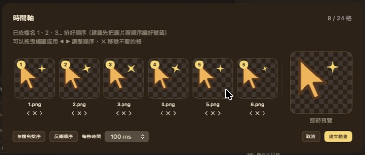
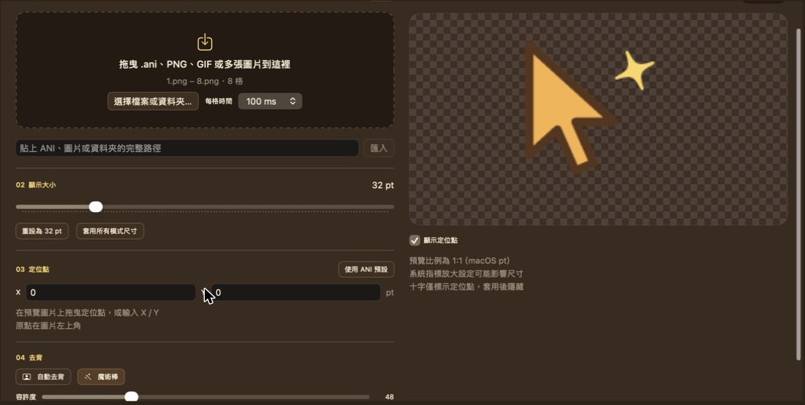

<div align="center">


# AniOnMac

**The animated cursor studio for your Mac**

Import `.ani`, PNG or GIF, remove backgrounds in one click, tune size and hotspot — and make the cursor truly yours.

[](#compatibility)
[](#compatibility)
[](https://github.com/lx3211/AniOnMac/releases/latest)

**English** · [繁體中文（臺灣）](README.tw.md) · [日本語](README.ja.md) · [한국어](README.ko.md)


</div>

---

## Highlights

| | |
| --- | --- |
| **Any source** | Windows `.ani`, a single PNG / JPG, an animated GIF (also APNG / WebP), or a whole folder of numbered images |
| **Timeline** | Several images open on a timeline — drag to reorder, nudge with ◀ ▶, drop frames, set the frame time, preview live |
| **Background removal** | **Auto** cuts out the subject with macOS Vision; the **magic wand** removes any colour you click |
| **Precise hotspot** | Drag on the 1:1 preview or type X / Y; the animation, timing and hotspot always stay in sync |
| **Hotspot calibration** | Click five dots with your own cursor; the app measures how far off the tip is and corrects the hotspot for you |
| **Drawing style** | Per mode: **High-res** (smooth edges), **Pixel** (visible square pixels) or **Jagged** (hard edges like classic pointers) |
| **Themes** | Unlimited numbered themes with an **In use** tag, auto-save and one-step undo |
| **Light & dark** | Follows the system or pick one; the dark palette is a warm, pudding-inspired brown and custard |
| **4 languages** | 繁體中文（臺灣）, English, 日本語, 한국어 — follows the system by default, menu bar included |
| **Updates** | Checks GitHub for new releases and new pushes |

## Installation

1. Download **`AniOnMac-macOS-universal.dmg`** from [**Releases**](https://github.com/lx3211/AniOnMac/releases/latest).
2. Double-click the DMG. In the window that opens, drag **AniOnMac** onto the **Applications** folder.
3. Eject the disk image: click the eject button next to **AniOnMac** in the Finder sidebar (or drag it to the Trash).
4. Open **AniOnMac** from **Applications** or Launchpad.

### Allowing the first launch

AniOnMac is not notarized by Apple, so macOS blocks it the first time:

1. A message says Apple could not verify AniOnMac. Click **Done** (do not move it to the Trash).
2. Open **System Settings → Privacy & Security** and scroll down to **Security**.
3. Next to "AniOnMac was blocked to protect your Mac", click **Open Anyway**.
4. Confirm with your password or Touch ID, then click **Open Anyway** in the dialog that follows.

From then on AniOnMac opens normally. Apple's own guide: [Open a Mac app from an unknown developer](https://support.apple.com/en-us/102445).

> [!TIP]
> If macOS says the app **is damaged and can't be opened**, the download is still quarantined. Run this in Terminal, then open the app again:
> `xattr -dr com.apple.quarantine /Applications/AniOnMac.app`

To update, quit AniOnMac and replace it in **Applications** with the new version; your themes are kept. A ZIP (`AniOnMac-macOS-universal.zip`) is also provided: unzip it and move `AniOnMac.app` to **Applications**, then follow the same steps.

## Quick start

1. Pick a mode at the top: **Arrow**, **Pointing**, **IBeam** or **Wait**.
2. Drop in an `.ani`, PNG, GIF or a folder of images.
3. Adjust size, style, hotspot and background, then press **Apply theme** (<kbd>⌘</kbd> <kbd></kbd>).

## Making a cursor

### From images

- **One image** becomes a static cursor.
- **One GIF** keeps its own frames and timing. GIFs with more than 24 frames are sampled evenly down to 24 while keeping the total length.
- **Several images or a folder** open on the timeline. Name them in order first (`1.png`, `2.png`, … `10.png`) — Finder order is used, so `10` comes after `9`. You can still reorder everything on the timeline.

<div align="center"></div>

### Removing the background

Open **04 Remove background** below the hotspot settings.

- **Auto remove** — detects the subject with macOS Vision. When nothing is detected (flat icons, pixel art), the edge colour is removed instead.
- **Magic wand** — the preview enlarges over a transparency checkerboard. Click a colour to remove the connected area; click enclosed areas separately. **Tolerance** controls how similar a colour must be.
- **Restore original** brings back the image from before removal.

Frame order, timing and hotspot are preserved for every source.

<div align="center"></div>

### Hotspot calibration

The hotspot is the exact point that clicks. If clicks land a little off from the tip you see, press **Calibrate** next to **03 Hotspot**:

1. Inside the calibration area the pointer turns into the cursor you are editing, at its real size.
2. Put the tip you see on the centre of each dot and click. There are five dots; a click too far from the dot is ignored.
3. The app averages the offsets (leaving out the one furthest from the rest) and shows the error and the corrected X / Y.
4. Press **Use this hotspot**, then **Apply theme**.

### Drawing style

Under **02 Size**, each mode has its own style:

| Style | Look |
| --- | --- |
| High-res | Smooth scaling with soft, anti-aliased edges (the default) |
| Pixel | Drawn on a coarse grid (one block is 2 pt), so the square pixels show |
| Jagged | Smooth inside, but every pixel is either solid or clear, giving stepped edges |

The preview and the calibration cursor show the chosen style exactly as it will be applied.

### Cursor modes

| Mode | When it shows |
| --- | --- |
| Arrow | The normal pointer |
| Pointing | Hovering links and interactive controls (not a mouse-down state) |
| IBeam | Selecting text |
| Wait | When macOS or an app is busy — the system decides when it appears |

Only the modes you fill in are applied; the others stay as they are. **Restore macOS appearance** puts all four back to Apple's own artwork at any time.

## Build from source

```sh
xcode-select --install          # Command Line Tools, if not installed yet
sh development/build.sh         # builds AniOnMac.app (arm64 + x86_64)
sh development/test.sh          # converter, cursor and app-state tests
sh development/package.sh       # zips the app for a release
```

> [!TIP]
> If the build stops with `external macro implementation type 'SwiftUIMacros.StateMacro' could not be found`, your Command Line Tools SDK lacks the SwiftUI macro plugin. Install Xcode, or build against an older SDK:
> `SDKROOT=/Library/Developer/CommandLineTools/SDKs/MacOSX26.5.sdk sh development/build.sh`

## <a id="compatibility"></a>Compatibility

| Item | Status |
| --- | --- |
| Minimum system | macOS 14 Sonoma |
| Apple Silicon | Tested on macOS 26 |
| Intel | Native x86_64 binary included; not tested on hardware |
| macOS 14 / 15 | Legacy cursor names supported; not tested on hardware |
| macOS 26 and later | Uses the ArrowS / IBeamS cursor names |
| Animation | Up to 24 frames per cursor (WindowServer limit) |

## Your data

Everything lives in `~/Library/Application Support/AniOnMac/`:

| Path | Contents |
| --- | --- |
| `library.json` | Themes, language, appearance and the theme in use |
| `assets/` | Imported cursor copies — the originals can be moved or deleted |
| `previews/` | Animation preview frames |
| `backups/` | One system cursor backup per theme, used by **Undo last change** |
| `native-reset-recovery.cape` | Cursor state from before the last **Restore macOS appearance** |

## Project layout

```text
AniOnMac/
├── README.md / README.tw.md / README.ja.md / README.ko.md
├── docs/images/               # Pictures used by the READMEs
└── development/
    ├── app/
    │   ├── Studio.swift       # Themes, storage, apply, undo, updates, background removal
    │   └── Views.swift        # Interface, timeline and animated previews
    ├── native/
    │   ├── ANIConverter.swift # ANI / image / GIF decoding, compose, background removal
    │   ├── cursorctl.m        # Registers system cursors, backups and verification
    │   ├── native_defaults.h  # Reads Apple's own cursor artwork
    │   └── CursorRefresh.m    # Live refresh and button cursors
    ├── resources/             # en / zh-Hant / ja / ko translations and the app icon
    ├── tests/                 # Converter, cursor and app-state tests
    ├── build.sh · test.sh · package.sh
    └── tools/                 # Icon generation
```

Adding a language is just another `development/resources/<code>.json` with a `languageName` entry — the app picks it up automatically.

---

<div align="center">

Made by **[lx3211](https://github.com/lx3211)** · [github.com/lx3211/AniOnMac](https://github.com/lx3211/AniOnMac)

</div>
