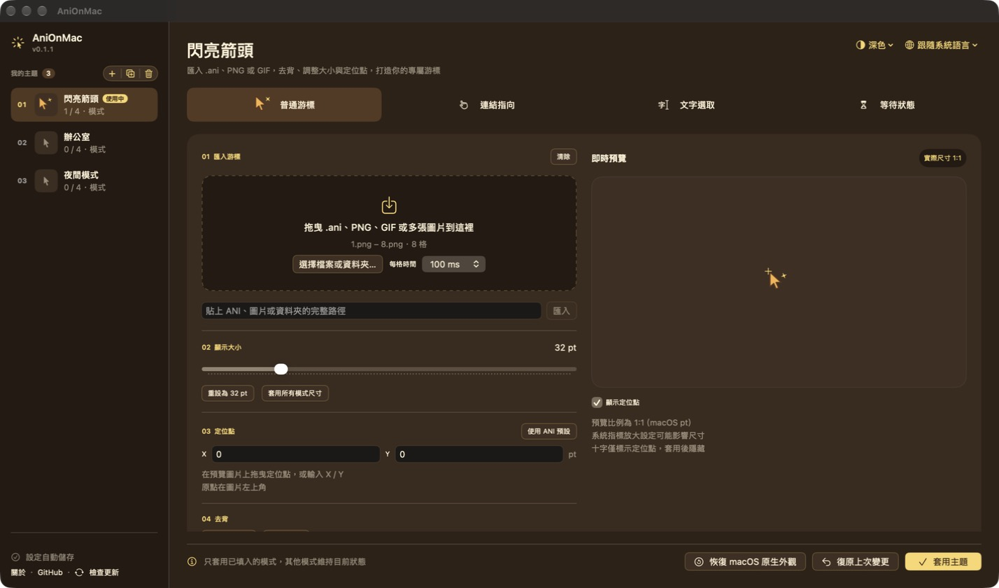

<div align="center">


# AniOnMac

**The animated cursor studio for your Mac**

Import `.ani`, PNG or GIF, remove backgrounds in one click, tune size and hotspot — and make the cursor truly yours.

[](#compatibility)
[](#compatibility)
[](https://github.com/lx3211/AniOnMac/releases/latest)

**English** · [繁體中文（臺灣）](README.tw.md) · [日本語](README.ja.md) · [한국어](README.ko.md)



</div>

---

## ✨ Highlights

| | |
| --- | --- |
| 🎞️ **Any source** | Windows `.ani`, a single PNG / JPG, an animated GIF (also APNG / WebP), or a whole folder of numbered images |
| 🧭 **Timeline** | Several images open on a timeline — drag to reorder, nudge with ◀ ▶, drop frames, set the frame time, preview live |
| 🪄 **Background removal** | **Auto** cuts out the subject with macOS Vision; the **magic wand** removes any colour you click |
| 🎯 **Precise hotspot** | Drag on the 1:1 preview or type X / Y; the animation, timing and hotspot always stay in sync |
| 🗂️ **Themes** | Unlimited numbered themes with an **In use** tag, auto-save and one-step undo |
| 🌗 **Light & dark** | Follows the system or pick one; the dark palette is a warm, pudding-inspired brown and custard |
| 🌐 **4 languages** | 繁體中文（臺灣）, English, 日本語, 한국어 — follows the system by default, menu bar included |
| 🔄 **Updates** | Checks GitHub for new releases and new pushes |

## 🚀 Quick start

1. Download `AniOnMac-macOS-universal.zip` from [**Releases**](https://github.com/lx3211/AniOnMac/releases/latest), unzip it and open `AniOnMac.app`.
2. Pick a mode at the top — **Arrow**, **Pointing**, **IBeam** or **Wait**.
3. Drop in an `.ani`, PNG, GIF or a folder of images.
4. Adjust size, hotspot and background, then press **Apply theme** (<kbd>⌘</kbd> <kbd>↩</kbd>).

> [!NOTE]
> The first launch may be blocked by [macOS security](https://support.apple.com/en-us/102445). Open **System Settings → Privacy & Security**, click **Open Anyway**, then **Open**.

## 🎨 Making a cursor

### From images

- **One image** becomes a static cursor.
- **One GIF** keeps its own frames and timing. GIFs with more than 24 frames are sampled evenly down to 24 while keeping the total length.
- **Several images or a folder** open on the timeline. Name them in order first (`1.png`, `2.png`, … `10.png`) — Finder order is used, so `10` comes after `9`. You can still reorder everything on the timeline.

<div align="center"></div>

### Removing the background

Open **04 Remove background** below the hotspot settings.

- **Auto remove** — detects the subject with macOS Vision. When nothing is detected (flat icons, pixel art), the edge colour is removed instead.
- **Magic wand** — the preview enlarges over a transparency checkerboard. Click a colour to remove the connected area; click enclosed areas separately. **Tolerance** controls how similar a colour must be.
- **Restore original** brings back the image from before removal.

Frame order, timing and hotspot are preserved for every source.

<div align="center"></div>

### Cursor modes

| Mode | When it shows |
| --- | --- |
| Arrow | The normal pointer |
| Pointing | Hovering links and interactive controls (not a mouse-down state) |
| IBeam | Selecting text |
| Wait | When macOS or an app is busy — the system decides when it appears |

Only the modes you fill in are applied; the others stay as they are. **Restore macOS appearance** puts all four back to Apple's own artwork at any time.

## 🛠️ Build from source

```sh
xcode-select --install          # Command Line Tools, if not installed yet
sh development/build.sh         # builds AniOnMac.app (arm64 + x86_64)
sh development/test.sh          # converter, cursor and app-state tests
sh development/package.sh       # zips the app for a release
```

> [!TIP]
> If the build stops with `external macro implementation type 'SwiftUIMacros.StateMacro' could not be found`, your Command Line Tools SDK lacks the SwiftUI macro plugin. Install Xcode, or build against an older SDK:
> `SDKROOT=/Library/Developer/CommandLineTools/SDKs/MacOSX26.5.sdk sh development/build.sh`

## <a id="compatibility"></a>🧩 Compatibility

| Item | Status |
| --- | --- |
| Minimum system | macOS 14 Sonoma |
| Apple Silicon | Tested on macOS 26 |
| Intel | Native x86_64 binary included; not tested on hardware |
| macOS 14 / 15 | Legacy cursor names supported; not tested on hardware |
| macOS 26 and later | Uses the ArrowS / IBeamS cursor names |
| Animation | Up to 24 frames per cursor (WindowServer limit) |

## 💾 Your data

Everything lives in `~/Library/Application Support/AniOnMac/`:

| Path | Contents |
| --- | --- |
| `library.json` | Themes, language, appearance and the theme in use |
| `assets/` | Imported cursor copies — the originals can be moved or deleted |
| `previews/` | Animation preview frames |
| `backups/` | One system cursor backup per theme, used by **Undo last change** |
| `native-reset-recovery.cape` | Cursor state from before the last **Restore macOS appearance** |

## 📁 Project layout

```text
AniOnMac/
├── README.md / README.tw.md / README.ja.md / README.ko.md
├── docs/images/               # Pictures used by the READMEs
└── development/
    ├── app/
    │   ├── Studio.swift       # Themes, storage, apply, undo, updates, background removal
    │   └── Views.swift        # Interface, timeline and animated previews
    ├── native/
    │   ├── ANIConverter.swift # ANI / image / GIF decoding, compose, background removal
    │   ├── cursorctl.m        # Registers system cursors, backups and verification
    │   ├── native_defaults.h  # Reads Apple's own cursor artwork
    │   └── CursorRefresh.m    # Live refresh and button cursors
    ├── resources/             # en / zh-Hant / ja / ko translations and the app icon
    ├── tests/                 # Converter, cursor and app-state tests
    ├── build.sh · test.sh · package.sh
    └── tools/                 # Icon generation
```

Adding a language is just another `development/resources/<code>.json` with a `languageName` entry — the app picks it up automatically.

---

<div align="center">

Made by **[lx3211](https://github.com/lx3211)** · [github.com/lx3211/AniOnMac](https://github.com/lx3211/AniOnMac)

</div>
