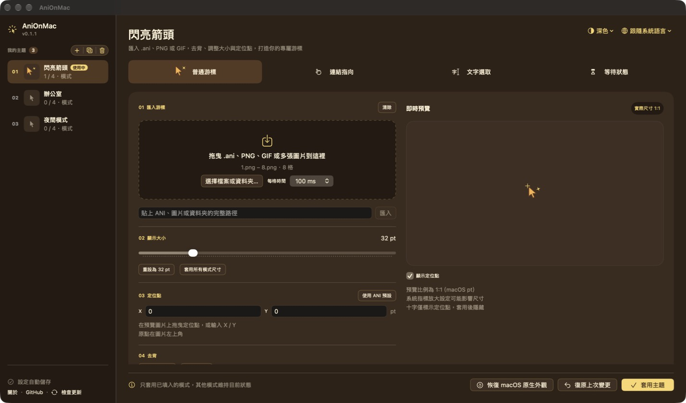
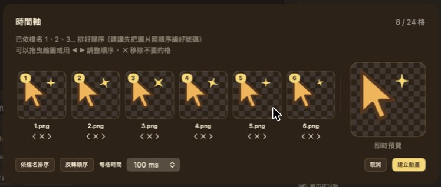
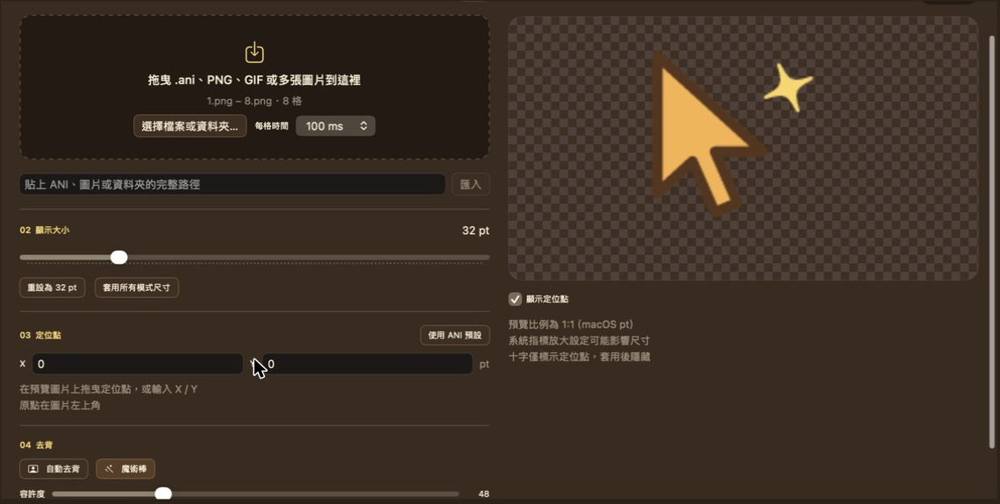

<div align="center">


# AniOnMac

**Mac 專屬的動態游標工作室**

匯入 `.ani`、PNG、GIF，一鍵去背、調整大小與定位點，打造獨一無二的滑鼠游標

[](#compatibility)
[](#compatibility)
[](https://github.com/lx3211/AniOnMac/releases/latest)

[English](README.md) · **繁體中文（臺灣）** · [日本語](README.ja.md) · [한국어](README.ko.md)



</div>

---

## 特色

| | |
| --- | --- |
| **什麼都能用** | Windows `.ani`、單張 PNG／JPG、會動的 GIF（也支援 APNG／WebP），或整個資料夾的編號圖片 |
| **時間軸** | 多張圖片會先開啟時間軸：拖曳排序、用 ◀ ▶ 微調、移除不要的格、設定每格時間，並即時預覽 |
| **去背工具** | **自動去背**用 macOS Vision 偵測主體；**魔術棒**點哪個顏色就移除哪個 |
| **精準定位點** | 在 1:1 預覽上拖曳或輸入 X／Y，動畫、速度與定位點永遠保持同步 |
| **定位點校正** | 用你自己的游標依序點 5 個點點，程式會量出尖端偏了多少並自動修正定位點 |
| **繪製風格** | 每個模式各自選擇：**高解析**（邊緣平滑）、**像素感**（看得到一格一格的方塊）或**鋸齒邊**（像舊式游標的硬邊） |
| **主題管理** | 主題自動編號，目前套用的主題有「使用中」標籤，自動儲存並可復原上一步 |
| **淺色與深色** | 跟隨系統或自行選擇，深色模式採用布丁風格的焦糖棕與卡士達黃 |
| **四種語言** | 繁體中文（臺灣）、English、日本語、한국어，預設跟隨系統，連選單列也一起切換 |
| **檢查更新** | 到 GitHub 檢查是否有新版本與新的推送 |

## 安裝

1. 從 [**Releases**](https://github.com/lx3211/AniOnMac/releases/latest) 下載 **`AniOnMac-macOS-universal.dmg`**。
2. 按兩下 DMG，在打開的視窗裡把 **AniOnMac** 拖到「**應用程式**」資料夾。
3. 退出磁碟映像檔：在 Finder 側欄按 **AniOnMac** 旁的退出按鈕（或拖到垃圾桶）。
4. 從「**應用程式**」資料夾或 Launchpad 打開 **AniOnMac**。

### 允許第一次開啟

AniOnMac 沒有經過 Apple 公證，所以第一次打開時 macOS 會擋下來：

1. 出現「Apple 無法驗證 AniOnMac」的訊息時，按「**完成**」（不要丟到垃圾桶）。
2. 打開「**系統設定 → 隱私權與安全性**」，往下捲到「**安全性**」。
3. 在「已阻擋 AniOnMac 以保護你的 Mac」旁邊，按「**強制打開**」。
4. 輸入密碼或使用 Touch ID 確認，再在接著出現的對話框按「**強制打開**」。

之後 AniOnMac 就能正常開啟。Apple 官方說明：[打開來自未識別開發者的 Mac App](https://support.apple.com/zh-tw/102445)。

> [!TIP]
> 如果 macOS 顯示 App「**已損毀，無法打開**」，代表下載的檔案還被隔離。在「終端機」執行下面這行，再重新打開 App：
> `xattr -dr com.apple.quarantine /Applications/AniOnMac.app`

更新時，先結束 AniOnMac，再用新版取代「應用程式」裡的舊版即可，主題設定都會保留。另外也有 ZIP 版（`AniOnMac-macOS-universal.zip`）：解壓縮後把 `AniOnMac.app` 移到「應用程式」，其餘步驟相同。

## 快速開始

1. 在上方選擇模式：**普通游標**、**連結指向**、**文字選取**或**等待狀態**。
2. 拖入 `.ani`、PNG、GIF 或一整個圖片資料夾。
3. 調整大小、繪製風格、定位點與去背，按下「**套用主題**」（<kbd>⌘</kbd> <kbd></kbd>）。

## 製作游標

### 用圖片製作

- **一張圖片**：做成靜態游標
- **一個 GIF**：保留原本的每一格與速度；超過 24 格會平均取樣成 24 格，總長度不變
- **多張圖片或資料夾**：會先開啟時間軸。建議先把檔名照順序編好號碼（`1.png`、`2.png`…`10.png`），排序方式和 Finder 相同，`10` 會排在 `9` 後面；在時間軸上也能隨時調整順序

<div align="center"></div>

### 去背

在定位點設定下方的「**04 去背**」：

- **自動去背**：用 macOS Vision 偵測主體；偵測不到時（例如扁平圖示、像素畫）改為移除邊緣底色
- **魔術棒**：預覽會放大並顯示透明棋盤格，點要移除的顏色，相連的相近顏色就會被移除；被包住的區域請分別點一下。**容許度**決定顏色要多接近才算同一色
- **還原原圖**：回到去背前的樣子

所有來源都會保留動畫順序、速度與定位點

<div align="center"></div>

### 定位點校正

定位點是游標真正點擊的位置。如果點下去的位置和你看到的尖端有點偏差，按「**03 定位點**」旁的「**校正**」：

1. 在校正區域裡，滑鼠會換成你正在編輯的游標，大小和套用後一樣。
2. 把你看到的尖端對準每個點點的中心後點一下，總共 5 個點；離點點太遠的點擊不會計入。
3. 程式會平均每次的誤差（去掉差最多的一次），顯示誤差與修正後的 X／Y。
4. 按「**使用這個定位點**」，再按「**套用主題**」。

### 繪製風格

在「**02 大小**」下方，每個模式可以各自選擇：

| 風格 | 效果 |
| --- | --- |
| 高解析 | 平滑縮放，邊緣柔和（預設） |
| 像素感 | 用較粗的格子畫（一格 2 pt），看得到一格一格的方塊 |
| 鋸齒邊 | 內部平滑，但每個像素不是實心就是透明，邊緣呈階梯狀 |

預覽和校正時的游標都會照選擇的風格顯示，和套用後一模一樣。

### 游標模式

| 模式 | 什麼時候出現 |
| --- | --- |
| 普通游標 | 一般的滑鼠指標 |
| 連結指向 | 移到連結或可互動的控制項上（不是按下滑鼠的狀態） |
| 文字選取 | 選取文字時 |
| 等待狀態 | macOS 或 App 忙碌時，由系統決定何時出現 |

只會套用你有設定的模式，其他維持原樣；隨時可以按「**恢復 macOS 原生外觀**」把四種游標換回 Apple 原本的樣子

## 從原始碼建置

```sh
xcode-select --install          # 尚未安裝 Command Line Tools 時
sh development/build.sh         # 建置 AniOnMac.app（arm64 + x86_64）
sh development/test.sh          # 轉檔、游標與 App 狀態測試
sh development/package.sh       # 打包成發佈用的 ZIP
```

> [!TIP]
> 如果建置時出現 `external macro implementation type 'SwiftUIMacros.StateMacro' could not be found`，代表 Command Line Tools 的 SDK 缺少 SwiftUI 外掛。安裝 Xcode，或改用較舊的 SDK 建置：
> `SDKROOT=/Library/Developer/CommandLineTools/SDKs/MacOSX26.5.sdk sh development/build.sh`

## <a id="compatibility"></a>相容性

| 項目 | 狀態 |
| --- | --- |
| 最低系統 | macOS 14 Sonoma |
| Apple Silicon | 已在 macOS 26 測試 |
| Intel | 內含原生 x86_64 版本，尚未在實機測試 |
| macOS 14／15 | 支援舊版游標名稱，尚未在實機測試 |
| macOS 26 以後 | 使用 ArrowS／IBeamS 游標名稱 |
| 動畫 | 每個游標最多 24 格（WindowServer 限制） |

## 資料存放位置

全部存放在 `~/Library/Application Support/AniOnMac/`：

| 路徑 | 內容 |
| --- | --- |
| `library.json` | 主題、語言、外觀與目前使用中的主題 |
| `assets/` | 匯入的游標副本，原始檔可以移動或刪除 |
| `previews/` | 動畫預覽影格 |
| `backups/` | 每個主題一份系統游標備份，供「**復原上次變更**」使用 |
| `native-reset-recovery.cape` | 上次「**恢復 macOS 原生外觀**」之前的游標狀態 |

## 專案結構

```text
AniOnMac/
├── README.md / README.tw.md / README.ja.md / README.ko.md
├── docs/images/               # README 使用的圖片
└── development/
    ├── app/
    │   ├── Studio.swift       # 主題、儲存、套用、復原、更新與去背
    │   └── Views.swift        # 介面、時間軸與動畫預覽
    ├── native/
    │   ├── ANIConverter.swift # ANI／圖片／GIF 解碼、組成動畫與去背
    │   ├── cursorctl.m        # 註冊系統游標、備份與驗證
    │   ├── native_defaults.h  # 讀取 Apple 原生游標圖
    │   └── CursorRefresh.m    # 即時更新與按鈕游標
    ├── resources/             # en／zh-Hant／ja／ko 翻譯與 App 圖示
    ├── tests/                 # 轉檔、游標與 App 狀態測試
    ├── build.sh · test.sh · package.sh
    └── tools/                 # 圖示產生工具
```

要新增語言，只要在 `development/resources/` 加一個含 `languageName` 的 `<語言代碼>.json`，App 就會自動列出

---

<div align="center">

作者 **[lx3211](https://github.com/lx3211)** · [github.com/lx3211/AniOnMac](https://github.com/lx3211/AniOnMac)

</div>
